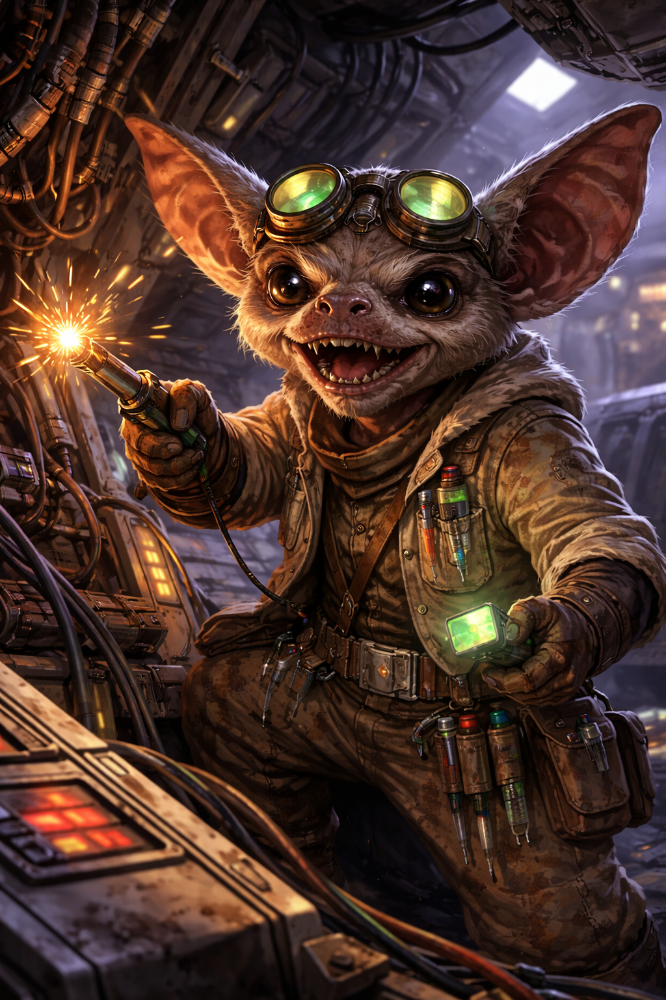

# Gune
### Player Character · Small Alien · Mechanic & Tech Specialist

← [Back to Campaign](../README.md)

---

## Overview

| | |
|---|---|
| **Species** | Small alien |
| **Role** | Mechanic, tech specialist, *Centennial Duck* engineer |
| **Ward** | [Henry](henry.md) — Wookiee rescued from slavery |

## Description

Small, furry, large-pointed ears, goggles, brown robes, utility equipment everywhere. Cheerful expression that borders on mischievous. Looks harmless. Is not useless.

## Relationships

| | |
|---|---|
| **[Henry](henry.md)** | Gune rescued Henry from slavery. Henry follows Gune completely. In the jail, Henry will only stay calm when he hears Gune's voice. |
| **[Captain Bora](captain-bora.md)** | Crewmate. Bora trusts Gune's technical instincts without question. |
| **[Indie](indie.md)** | The ship is Indie's to fly and Gune's to keep alive. They have an understanding. |

## Character Notes

Gune's relationship with [Henry](henry.md) is central to the Jailbreak episode. He's the only one who can calm Henry mid-rage. The lock-picking approach in the jailbreak is built around his skills.

## GM Secret: The Stowaway

*Not yet revealed in play. Captain Bora doesn't know.*

Gune kidnapped an Imperial officer on Kwenn Space Station (Episode 1) and has been hiding him in Cargo Hold 2 of the *Centennial Duck* ever since. The officer is probably the one whose uniform Eck and Gune wore. The clues surface in [The Resupply Bill](../sessions/season-2/the-resupply-bill.md).

## Stats
*Player-managed character sheet.*

## Rap Sheet

*Running record of infractions and penalties. See the [Heat Index](../README.md#heat-index).*

| Jurisdiction | Heat | Bounty |
|---|---|---|
| Mos Eisley | ●○○ 1 | 250 cr |

| Day | Where | Infraction | Penalty | Status |
|---|---|---|---|---|
| Day 2, late night | Mos Eisley | Jailbreak: broke Henry and Torbek out of the police station. Set off the alarm and was caught on the station's security holocams. | **250 cr bounty** (Mos Eisley Police, posted at Puggles Trodd's registration board) | Open |

---

*← [Player Characters](../README.md#player-characters)*
